# ⏱ STITimer

**Event Timer & Contest Management Display** · `Windows Forms`

Multi-purpose event timer application for school contests and activities with customizable themes, countdown/stopwatch modes, and projector-ready display.

## Why This Project

School competitions live and die by visible timing — yet organizers were running them on phone stopwatches and borrowed wall clocks that nobody in the audience could see, with one student hunched over a laptop muttering the remaining time to the judges. Fairness suffered: disputes over "when did the clock really start?" were unavoidable, and every contest needed a different timing setup cobbled together at the last minute. STITimer was built in a 12-hour sprint for a college competition to fix exactly that: one laptop, one projector, and every contest gets a branded, audience-readable timer.

The app was made for competition organizers, emcees, and judges at STI College events. Each preset carries its own contest theme art, default duration, and timing mode — 36-hour marathon countdowns for CODEFEST, three-hour bake-a-thons, 30-minute impromptu challenges, phased prep/speech rounds, and tiered quiz limits — replacing ad-hoc phone timers with a single projector-ready display that was actually deployed at THM Week, Tagisan ng Talino, and other live contests.

## How It Works

1. The event host opens STITimer on the venue laptop; the launcher shows every contest preset with its themed artwork, and F11 drops the window into true full-screen for the projector.
2. For CODEFEST, the host clicks the contest tile; `TimerWindow` opens with the CODEFEST background and a 36-hour countdown already loaded, then the host presses start.
3. The countdown runs off an elapsed-time clock (not tick counting), so it stays accurate for hours; as time runs out the overlay blinks red to warn the whole room that the deadline is imminent.
4. For speed contests like CHEF XPRESS or MIX N' FLAIR, the host picks a stopwatch preset instead; judges start, pause, and read elapsed time in big digits from across the gymnasium.
5. STAND UP AND DELIVER uses the phased timer: a 30-second blue preparation window, then the speech window running green, turning yellow at the warning threshold and red at the finish.
6. THINK QUEST opens the quiz timer with Easy/Medium/Hard preset cards (15/30/45 seconds, editable on the spot) so the emcee can escalate difficulty between rounds.
7. Between rounds, the organizer can pull up the event's branding splash and dismiss it with Escape, fading cleanly back to the launcher for the next contest.

## Modules

### Event Launcher
The `MainWindow` contest grid: one themed tile per event (CODEFEST, WORTH THE WHISK, ESSAY DOES IT!, ALL IN PLACE, CHEF XPRESS, TRAVELOGUE, MIX N' FLAIR, STAND UP AND DELIVER, THINK QUEST), each wired to its window with the right default duration, plus an F11 full-screen toggle and a banner tile that opens the branding splash.
**Scenario:** The emcee has four contests left on the afternoon program; she clicks the ALL IN PLACE tile and a 30-minute countdown opens instantly with that contest's artwork — no durations to type, no window to configure between events.

### Countdown Timer
`TimerWindow` runs drift-free countdowns with hours/minutes/seconds fields (numeric-only input, auto-clamped to 60), start/pause/reset controls, and a red blink overlay for the final stretch so a deadline is unmissable from the back of the hall.
**Scenario:** CODEFEST participants glance at the projector and see 35:59:12 remaining on their own themed screen; at 10 minutes left the overlay turns red and starts blinking, and the emcee stops the clock at exactly zero with one keypress.

### Stopwatch Mode
`StopwatchWindow` measures elapsed time with accumulate-and-pause semantics, displaying hours, minutes, and seconds in projector-scale digits under the contest's own background image.
**Scenario:** At CHEF XPRESS the judges press start when the chef's pan hits the flame and pause when the plate is served; the screen reads 00:04:37, giving the panel an objective speed score to weigh alongside presentation.

### Phased Prep & Speech Timer
`TrafficLightWindow` runs multi-stage rounds — preparation first, then speech — with color-coded overlays (blue prep, green speech, yellow warning at a configurable threshold, red finish) so contestants and the audience know exactly which phase is live.
**Scenario:** For STAND UP AND DELIVER, the host launches the preset with 30 seconds of prep and 2 minutes of speech; the stage screen glows blue while speakers organize their notes, flips green when delivery begins, yellows at the 30-second warning, and ends red with the room applauding on time.

### Quiz Difficulty Timer
`ThinkQuestWindow` provides color-coded Easy/Medium/Hard preset cards with editable per-tier durations (default 15/30/45 seconds) and the same red-blink final warning as the main countdown.
**Scenario:** During THINK QUEST, the host taps the orange Medium card to give the round 30 seconds per question; when a team hesitates on the final toss, the screen flashes red and the proctor calls time exactly as it hits zero.

### Event Branding & Splash
`LogoWindow` is the dismissible event branding splash, launched from the launcher banner, showing the STI / Tagisan ng Talino identity with a smooth Escape-triggered fade — backed by a full library of per-contest theme images in `Images/`.
**Scenario:** Before the program resumes, the organizer puts the Tagisan ng Talino splash on the projector during the break; when the next round is ready, he presses Escape and the logo fades out to reveal the launcher for the next contest tile.

## Features

- Countdown and elapsed-time (stopwatch) modes
- Contest-specific timer presets with themed backgrounds
- Preparation and speech duration settings
- Difficulty-based quiz timers (Easy/Medium/Hard)
- Projector-friendly full-screen display
- Event photo documentation from real deployments

## Tech Stack

- C#
- WPF
- .NET

## About

A Windows desktop timer application designed for school events and competitions. Each contest gets its own themed timer display. Supports countdown, stopwatch, and quiz modes with configurable durations. Deployed and used at STI College events.

## Screenshots

### Live deployment proof — the timer projected on-screen during the "ALL IN PLACE" contest shows the app in real-world use. Judges and contestants rely on this display for fair, visible timekeeping.

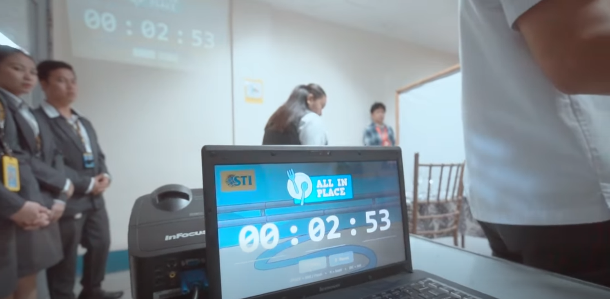

### Stopwatch mode in action — "CHEF XPRESS" uses elapsed-time tracking to measure how long competitors take. The laptop setup demonstrates portability: any venue with a projector becomes a competition stage.

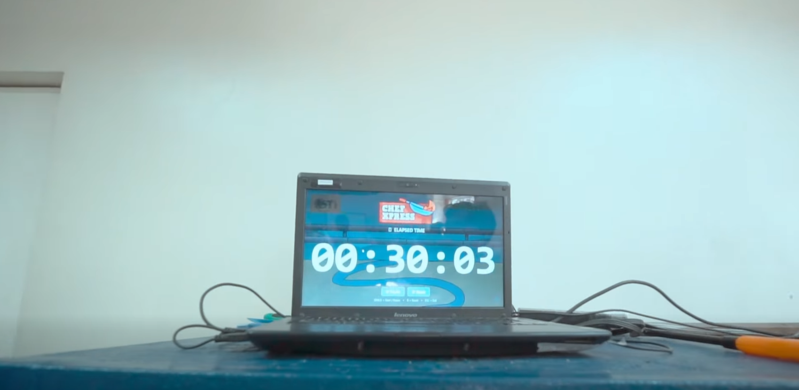

### Event documentation — the "TRAVELOGUE" contest timer with an audience member visible shows the app's role in live event production where timing accuracy affects scoring.

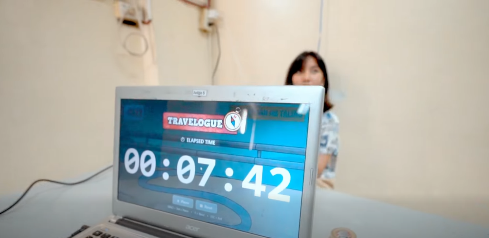

### Venue context — the THM WEEK gymnasium shot shows the scale of events STITimer supports: stage, judges' table, and audience all depend on synchronized, visible timing.

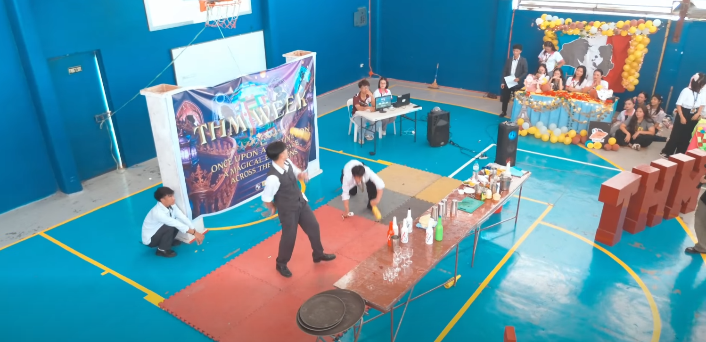

### Long-duration countdown — CODEFEST uses a 36-hour countdown, demonstrating the timer's ability to handle marathon coding competitions where participants need a persistent time reference.

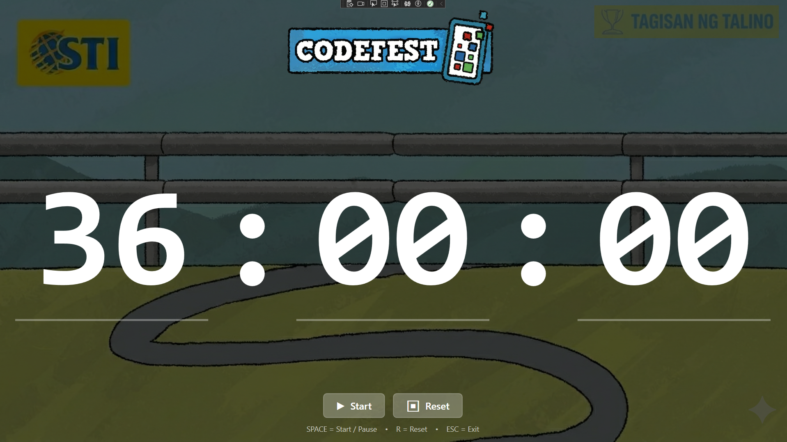

### Essay contest timer — "ESSAY DOES IT!" with a 1-hour countdown provides a visible deadline for written competitions, keeping both proctors and writers aware of remaining time.

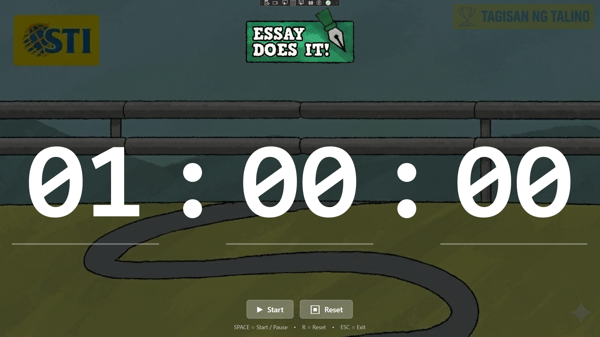

### Stopwatch for creative contests — "MIX N' FLAIR" tracks elapsed time so judges can score speed alongside quality in bartending/mixology competitions.

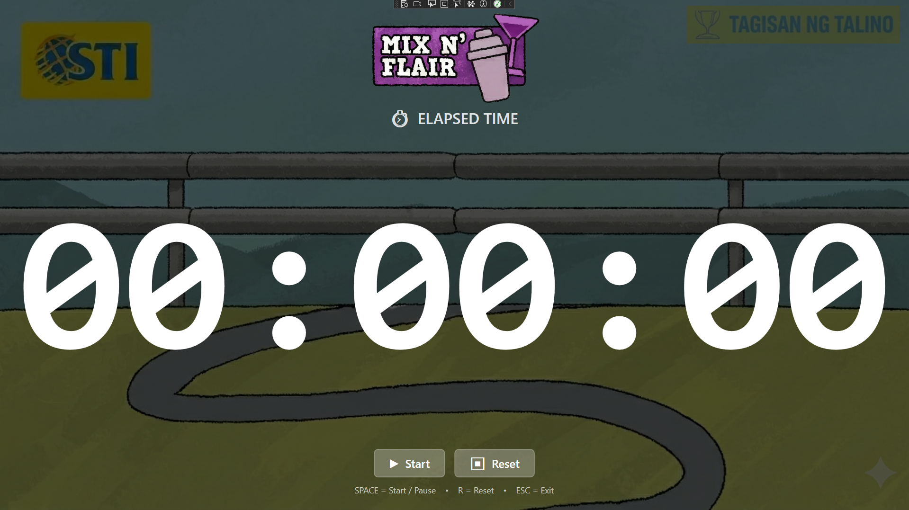

### Preparation mode — "STAND UP AND DELIVER" separates prep time (00:30) from speech time, giving speakers a structured countdown for each phase of their presentation.

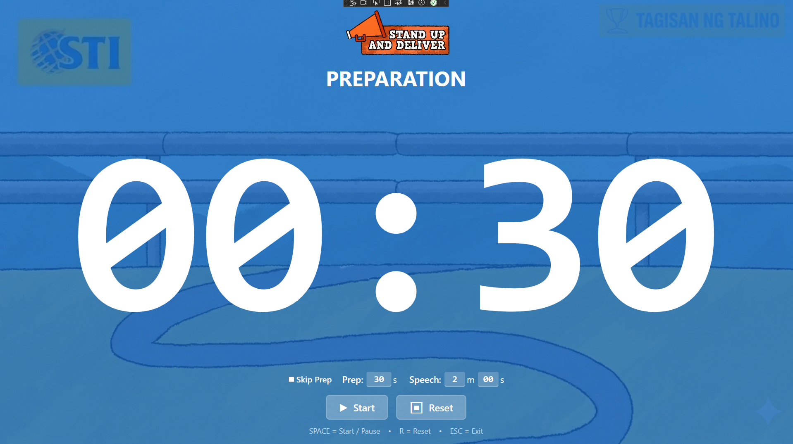

### Quiz difficulty timer — "THINK QUEST" uses tiered time limits (15s/30s/45s for Easy/Medium/Hard) to create escalating tension in trivia competitions.

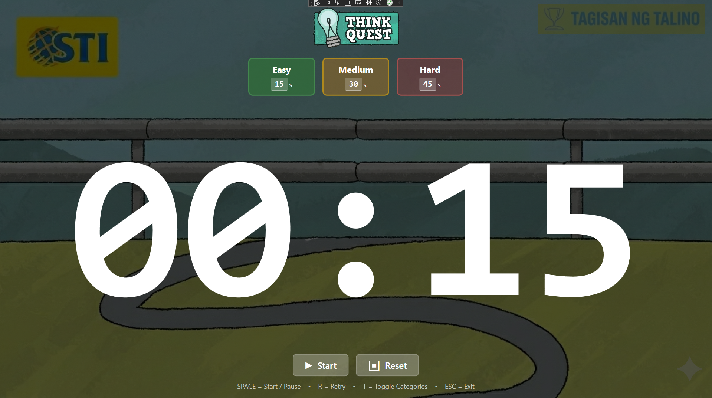

### Travelogue stopwatch — measures presentation duration for travel documentary pitches, ensuring each contestant gets equal time.

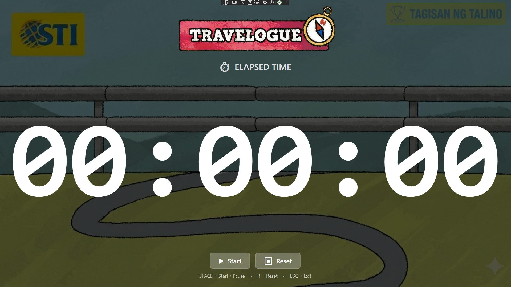

### Cooking contest countdown — "WORTH THE WHISK" gives bakers 3 hours with a clear visual countdown projected for all participants to see.

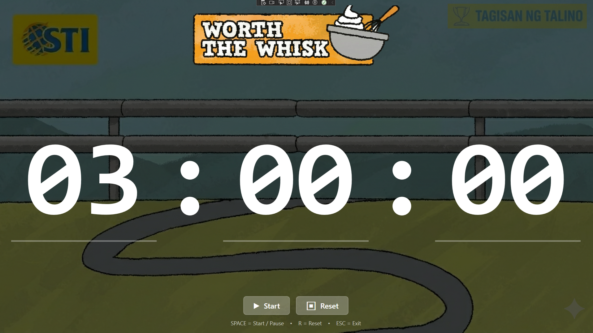

---

Built by [Mark Crysler Baddo](https://github.com/Kuraisura) · [Portfolio](https://kuraisler.xyz)
